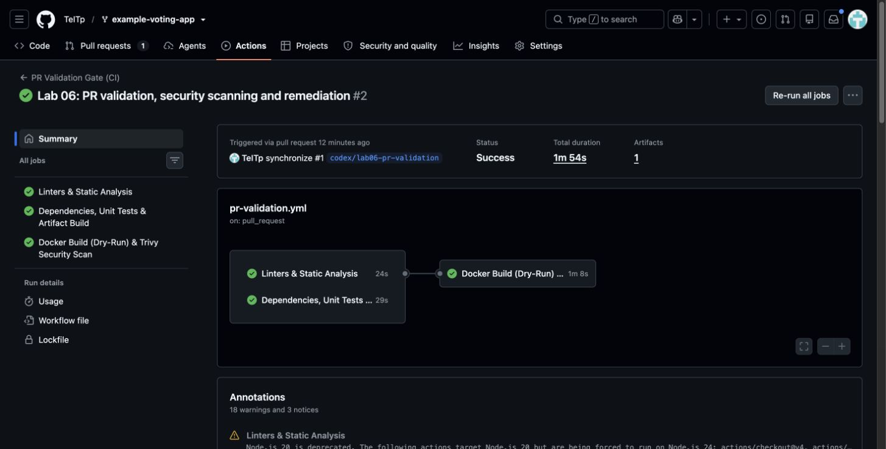
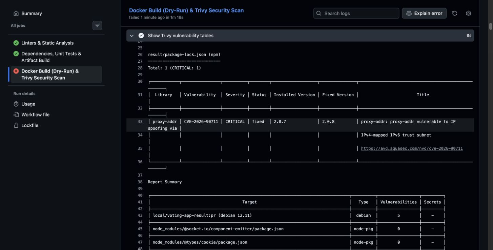
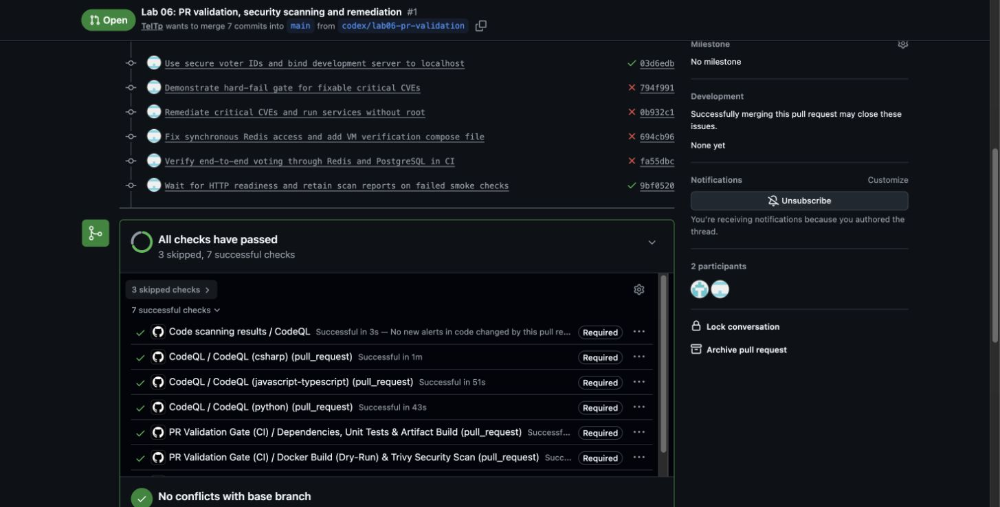
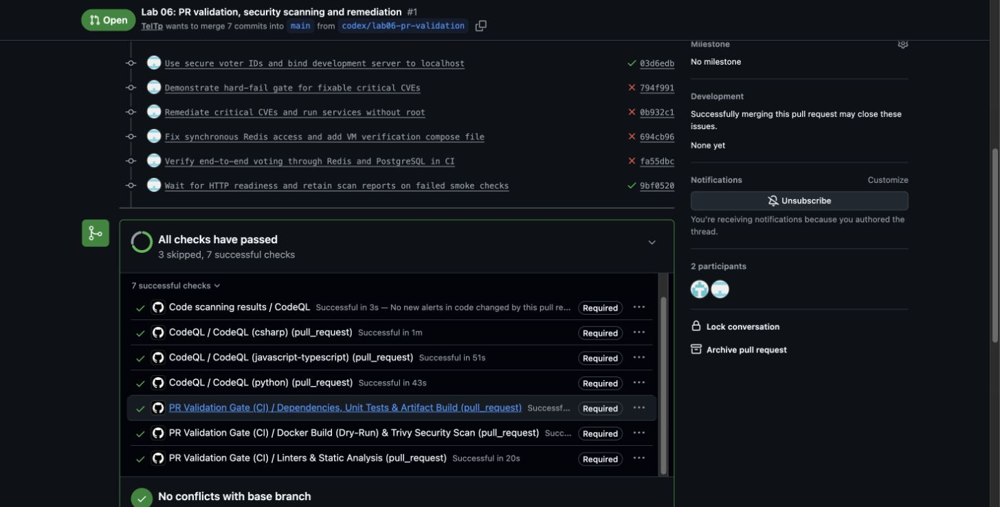
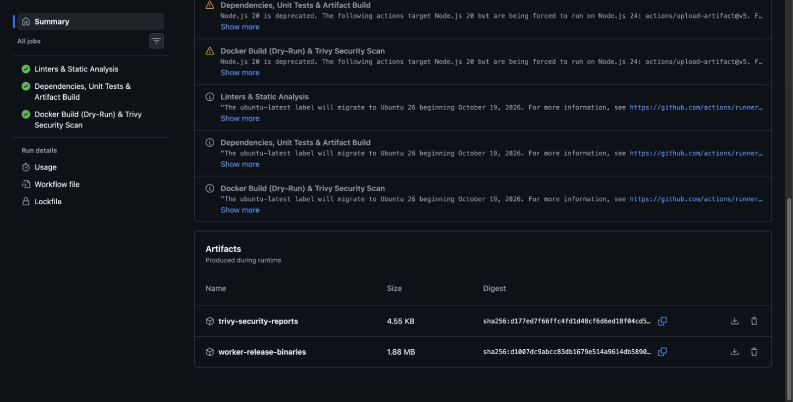
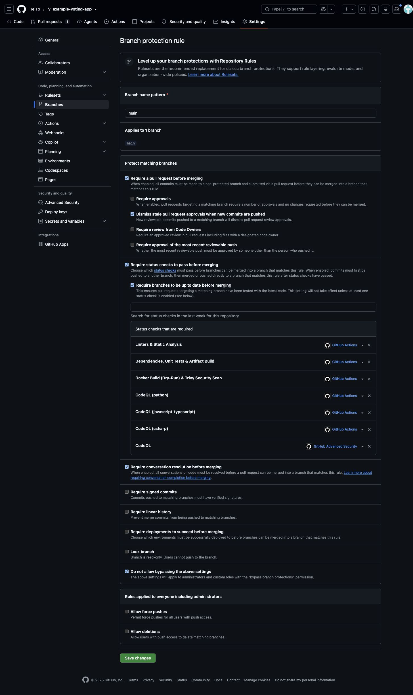

# Лабораторна робота 06 — PR Validation Pipeline

**Виконав:** Кушнір Андрій, КН-41.  
**Тема:** Quality & Security Gate для Example Voting App.  
**Мета:** реалізувати Shift-Left Security: перевіряти код, залежності, артефакти й Docker-образи до злиття в `main`.

## 1. Репозиторій та реалізація

[Pull Request №1](https://github.com/TeITp/example-voting-app/pull/1) створено з гілки `codex/lab06-pr-validation` у `main`.

| Файл | Призначення |
| --- | --- |
| [vote/test_app.py](../../vote/test_app.py) | Flask-тести сторінки та обох варіантів голосування; Redis замінюється mock-об’єктом |
| [pr-validation.yml](../../.github/workflows/pr-validation.yml) | Перевірки PR до `main`, без публікації образів |
| [codeql.yml](../../.github/workflows/codeql.yml) | CodeQL для Python, JavaScript/TypeScript та C# |
| [docker-compose.production.yml](../../docker-compose.production.yml) | Перевірка повного стеку на локальних портах існуючої VM |
| [evidence](./evidence/) | Фактичні текстові результати та параметри захисту гілки |

У вихідному репозиторії немає `result/tests/tests.js`, наведеного в методичці. Тому перевіряється реальний файл `result/tests/render.js`.


Успадковані workflow публікації в реєстри `dockersamples` обмежені вихідним репозиторієм: у цьому форку вони пропускаються. Новий CI не має кроку push у Docker Hub/ACR і не потребує облікових даних реєстру.

## 2. Перевірки пайплайну

1. **Linters & Static Analysis:** Hadolint для трьох Dockerfile, Flake8 для критичних помилок Python, Bandit для знахідок рівня MEDIUM/HIGH, аналізатори C# з помилкою при попередженнях.
2. **Dependencies, Unit Tests & Artifact Build:** встановлення Python/npm/NuGet-залежностей, три pytest-тести, синтаксична перевірка Node.js, збірка і `dotnet publish` Worker. Артефакт `worker-release-binaries` містить `Worker.dll`.
3. **Docker Build (Dry-Run) & Trivy Security Scan:** локальна збірка всіх трьох образів; перевірка непривілейованого користувача Vote; HTTP-перевірка; інтеграційний тест запису голосу через Redis і Worker до PostgreSQL; сканування файлової системи і всіх трьох образів.
4. **CodeQL:** окремі перевірки Python, JavaScript/TypeScript та C#. Для C# використано підтримуваний режим аналізу без збірки; реальна компіляція додатково виконується в основному CI.

Команди локального запуску тестів:

```bash
cd vote
python -m pip install -r requirements.txt pytest
python -m pytest test_app.py -v
```

Результат: **3 passed**. Тести перевіряють HTTP 200, обидва варіанти вибору, cookie виборця та правильний JSON у черзі Redis. Зовнішній Redis для юніт-тестів не потрібен.

## 3. Інформаційний та жорсткий режими

[Початковий успішний запуск](https://github.com/TeITp/example-voting-app/actions/runs/42323489898) використовував `severity: HIGH,CRITICAL` та `exit-code: '0'`.
Виявлені CVE друкувалися, але не блокували пайплайн. У `result/package-lock.json` було **11 HIGH і 1 CRITICAL**; у Vote-образі — **53 HIGH, 0 CRITICAL** за базою сканера на момент запуску.

Після ввімкнення `exit-code: '1'`, `severity: CRITICAL` та `ignore-unfixed: true` [запуск став червоним](https://github.com/TeITp/example-voting-app/actions/runs/42323765195).
Це реальне падіння через знайдені CVE, а не штучний `exit 1`.

| Ділянка | Знахідки до виправлення в жорсткому режимі |
| --- | --- |
| npm lockfile | 1 CRITICAL |
| Vote image | 0 CRITICAL, для яких доступне виправлення |
| Result image | 5 системних + 2 пакетних CRITICAL |
| Worker image | 6 системних + 1 .NET CRITICAL |

Цифри описують знахідки в різних областях аналізу; вони можуть повторювати одну CVE в кількох пакетах/образах, тому їх не слід трактувати як кількість унікальних CVE.

Конкретні приклади з логів:

| CVE | Компонент до змін | Виправлення зі звіту / виконана дія |
| --- | --- | --- |
| CVE-2026-90711 | proxy-addr 2.0.7 | Fixed Version 2.0.8; оновлено npm-залежності та lockfile |
| CVE-2026-33845, CVE-2026-42010 | libgnutls30 у старих Debian-образах | Перехід на підтримувані базові образи |
| CVE-2026-59873 | tar 6.2.1 у Node-образі | Оновлено Node-образ; сканер указував 7.5.19 |
| CVE-2021-24112 | System.Drawing.Common 5.0.0 | Оновлено .NET і NuGet-залежності; сканер указував 5.0.3 |



Повні звіти: [dependencies](./evidence/before-dependencies.txt), [Result](./evidence/before-result.txt), [Vote](./evidence/before-vote.txt), [Worker](./evidence/before-worker.txt).

## 4. Усунення вразливостей

[Перевірений запуск після виправлень](https://github.com/TeITp/example-voting-app/actions/runs/42324475551) завершився **Success**.
[CodeQL](https://github.com/TeITp/example-voting-app/actions/runs/42324475559) також успішний для всіх трьох мов.
Trivy у файловій системі та кожному з трьох образів показав **0 CRITICAL, для яких доступне виправлення**, при `exit-code: '1'`.
Підтвердження: [залежності](./evidence/after-dependencies.txt), [Vote](./evidence/after-vote.txt), [Result](./evidence/after-result.txt), [Worker](./evidence/after-worker.txt).

Артефакт `worker-release-binaries` реально завантажено та перевірено на наявність `Worker.dll`; [перелік файлів](./evidence/worker-artifact-contents.txt).


- Vote: `python:3.13-slim-bookworm`; зафіксовано Flask 3.1.3, redis 8.1.0 та gunicorn 26.2.0.
- Result: `node:24-bookworm-slim`; оновлено прямі залежності та транзитивні пакети у `package-lock.json`; локальний `npm audit` після оновлення показав **0 vulnerabilities**.
- Worker: підтримуваний .NET 10; StackExchange.Redis 3.4.31, Npgsql 10.0.3, Newtonsoft.Json 13.0.4.
- Прибрано непотрібні `curl`, `tini` і глобальний `nodemon` з вебобразів. Healthcheck Vote використовує стандартний Python; розробницький Result використовує `node --watch`.
- Dockerfile проходять Hadolint з `failure-threshold: warning`; ігнорування правил для приховування помилок не додавалося.
- У Flask вимкнено debug, локальний development server слухає loopback, ідентифікатор виборця створюється через `secrets.token_hex(16)`.
- Новий аналізатор Redis виявив синхронне очікування `ListLeftPopAsync(...).Result`. Для синхронного циклу Worker використано відповідний синхронний API `ListLeftPop(...)`.

`--no-cache-dir` керує кешем pip і саме по собі не фіксує версії пакетів: версії зафіксовано в `requirements.txt`.
Файлу `.trivyignore` немає; знайдені CRITICAL не приховувалися винятками.

У фінальному режимі блокуються **CRITICAL, для яких доступне виправлення**. `ignore-unfixed: true` означає, що відсутність таких знахідок не доводить відсутності всіх HIGH або невиправлених CVE. Результат сканування залежить від дати бази вразливостей.





## 5. Non-root і перевірка роботи

У Vote створено `appuser`, UID **10001**. Фінальний Gunicorn працює під цим UID і слухає **8080**. У локальному Compose відповідність портів — `5000:8080`.
Result працює під UID 1000, Worker — під UID 1654. Копіювання файлів у Dockerfile враховує власника.

CI перевіряє UID через `id -u`, отримує сторінку Vote через HTTP і окремо запускає весь Compose-стек. Інтеграційний тест надсилає голос та чекає появи запису в таблиці `votes` PostgreSQL. Тимчасовий CI-стек видаляється після перевірки.



## 6. Захист main

Для `main` увімкнено обов’язковий Pull Request, актуальність гілки відносно бази та успішні статуси:

- Linters & Static Analysis;
- Dependencies, Unit Tests & Artifact Build;
- Docker Build (Dry-Run) & Trivy Security Scan;
- CodeQL (python), CodeQL (javascript-typescript), CodeQL (csharp), CodeQL.

Захист поширюється на адміністраторів; force push і видалення `main` заборонено. Параметри перевірено через GitHub API і збережено в [branch-protection.json](./evidence/branch-protection.json).



## 7. Azure

Під час перевірки Azure Portal знайдено наявну запущену Linux VM із Docker, Compose та Git. До цієї роботи на ній був лише завершений контейнер `hello-world`.
У списку ресурсів активної підписки ACR не знайдено. Використано перевірку на існуючій VM без створення нового реєстру та без розширення мережевих правил.

**Фактична перевірка на Azure VM успішна.** Розгорнуто коміт `9bf0520ee49695275012e758c959586b52b23aca` після проходження всіх його обов’язкових PR-перевірок.
Vote та Result повернули **HTTP 200**, користувач Vote — **UID 10001**.
Після POST із `vote=b` відповідний запис з’явився в PostgreSQL.
Працюють усі п’ять контейнерів; Vote, Redis і PostgreSQL мають стан healthy.
[Результат Azure Run Command](./evidence/azure-verification.txt).

Для запуску повного стеку використовується:

```bash
docker compose -p lab06-voting -f docker-compose.production.yml up -d --build --wait
curl --fail http://127.0.0.1:5000/
curl --fail http://127.0.0.1:5001/
```

Ця конфігурація публікує вебпорти лише на `127.0.0.1` VM. Це перевірка контейнерного запуску; окремий ACR/CD-пайплайн не налаштовувався в межах додаткового завдання.

## Висновок

Створено PR-перевірки, юніт-тести Vote, артефакт Worker, сканування Trivy та CodeQL, захист `main`. Зафіксовано перехід від інформаційного режиму до реального блокування через CVE, після чого оновлено компоненти. Перевірено роботу непривілейованих контейнерів і повний шлях голосу до PostgreSQL як у CI, так і на наявній Azure VM. Мету додаткового завдання та бонусну перевірку non-root досягнуто.

Практичні труднощі: невідповідність імені JS-тестового файлу методичці, застарілий .NET 7, новий аналізатор Redis та потреба дочекатися готовності HTTP-сервера перед smoke-тестом. Ці перевірки доповнюють одна одну: успішна компіляція не доводить працездатності сервісу або відсутності вразливостей.
